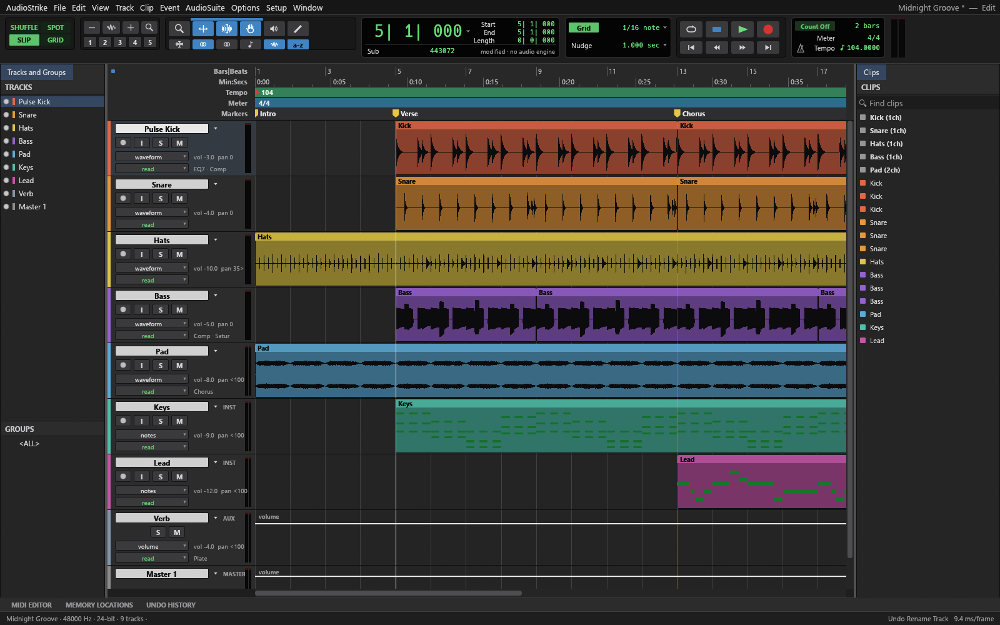
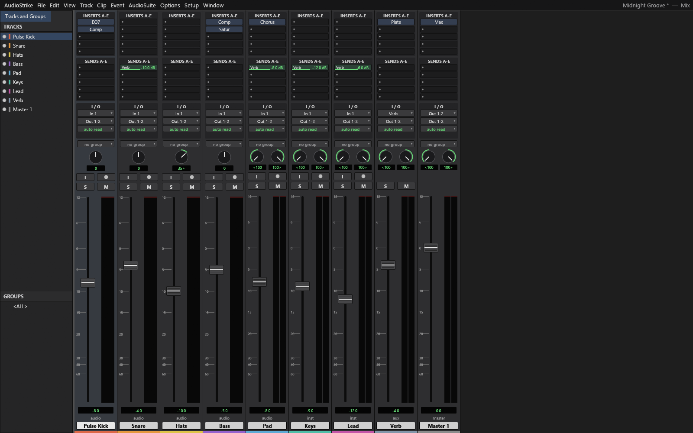

<p align="center">
  
</p>

<h1 align="center">AudioStrike</h1>

<p align="center">
  <a href="https://prowebdevsolutions.com"><picture>
    <source media="(prefers-color-scheme: dark)" srcset="assets/branding/PWDS-logo-orange.svg">
    
  </picture></a>
</p>

<p align="center"><strong>Shape a session, then render the mix.</strong></p>

AudioStrike brings track editing, a mix workspace, editable `.scraft` sessions, and WAV export into a Rust desktop source project.

<p align="center"><a href="#inside-the-workspace">Workspace</a> · <a href="#build-from-source">Build from source</a> · <a href="#bring-an-earlier-project-forward">Legacy conversion</a> · <a href="#current-status">Current status</a> · <a href="UPSTREAM.md">Source provenance</a></p>


*The retained Windows app running its built-in synthesized “Midnight Groove” demo at 1600 × 1000. Tracks, clips, waveform previews, markers, timeline, and transport are rendered by AudioStrike. Playback hardware was disabled for this capture.*

## Inside the workspace

### Arrange and revise tracks

Select and edit tracks beside their clips and waveform previews. The screenshot below shows a real in-app rename from “Kick” to “Pulse Kick”; the changed name appears in the track list and lane. The demo was not saved for the README.



### Shape a mix

The Mix view exposes inserts, sends, routing, pan controls, meters, and channel faders. After the rename, the selected Pulse Kick track was set to −8 dB with AudioStrike’s `mix.volume` command. The Mix capture shows its changed fader value. This was a UI and document-state check with the audio engine disabled, not an audibility test.



### Keep an editable session and export for review

The foundation uses an editable `.scraft` session and can render a separate WAV. A prior bounded command-line workflow converted a supported older project, edited and reopened the new session, then exported a **non-silent WAV**. That result supports the CLI path; the screenshots above show a different, unsaved demo session.

## Bring an earlier project forward

The earlier AudioStrike preview used a `.audiostrike` directory, which is a different format. Use an explicit copy-based conversion:

```text
audiostrike-cli migrate-legacy SOURCE.audiostrike OUTPUT.scraft [--current-state-only]
```

The command leaves the old project and media untouched. The new session refers to that media by absolute path, so keep it available. Existing undo history stays in the old project and requires `--current-state-only`. The converter refuses unsupported pan, fades, overlapping clips, mixed-channel tracks, gains, malformed input, and uncertain recovery state. It does not promise a sample-identical mix.

## Build from source

Use Rust 1.95 or newer and reviewed Cargo dependencies. The UI dependency is pinned to `storytold/craft-libs` revision `5c874d51eeb3de70e735c8ce87a59a7dedd47675`.

```powershell
cargo fetch --locked --target x86_64-pc-windows-msvc
cargo test --locked --offline --workspace
cargo build --locked --offline -p soundcraft -p soundcraft-cli --bins
```

The Windows binaries are `audiostrike` and `audiostrike-cli`; retained `soundcraft-*` crate names and `.scraft` files support source compatibility. A fresh checkout needs space and dependencies before building.

## Current status

This is a **pre-alpha source checkpoint**. An earlier Windows workspace run passed 612 tests with one ignored, and a synthetic CLI conversion/edit/reopen/export path produced a non-silent WAV. For this README, a retained Windows executable was launched and exercised with the built-in synthesized demo: a track rename, volume change, Edit view, and Mix view were visually checked. This was not a new clean-checkout build or workspace test. Device playback, recording, third-party plugins, accessibility, general format fidelity, and release packaging remain unverified. No release binary is provided. [Screenshot provenance](docs/SCREENSHOT_PROVENANCE.md) records the executable hash, source match, capture steps, and image hashes.

AudioStrike adapts the complete [SoundCraft](https://github.com/storytold/soundcraft) Rust source at `480b0b2dd75df388d79746a035652069a9bdcbc6`. The donor MIT/Apache licenses and `NOTICE` remain. [UPSTREAM.md](UPSTREAM.md) records provenance, [ATTRIBUTION.md](ATTRIBUTION.md) distinguishes included donor work and new documentation captures, and [DEPENDENCY_RESOLUTION.md](DEPENDENCY_RESOLUTION.md) records the pinned UI dependency. The original AudioStrike repository logo is included at [`assets/branding/AudioStrike.png`](assets/branding/AudioStrike.png); upstream brand assets and app icon are excluded. Integration of that logo as an executable icon has not been verified. A transitive binary notice audit remains before distribution.

Explore the other [PWDS Strike repositories](https://github.com/Gerbzz?tab=repositories&q=Strike).

## PWDS brand artwork

The company mark in this masthead is the existing [official PWDS logo](https://github.com/Gerbzz/PWDS-Website/blob/main/public/prowebdevsolutions-logo.png), with the [official orange display asset](https://prowebdevsolutions.com/images/prowebdevsolutions-logo-orange.svg) for dark backgrounds. The app logo above it remains the original Strike suite artwork.
